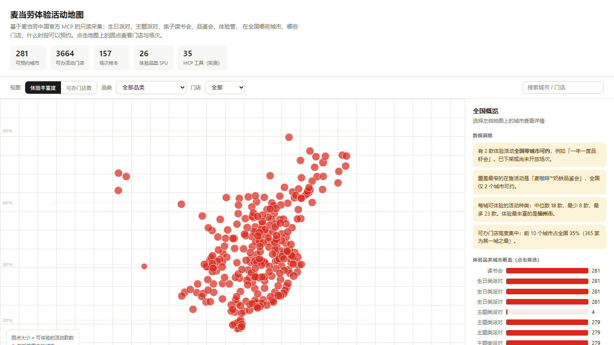

# 麦当劳体验活动地图 · mcd-experience-atlas

> 「我在成都，能办麦当劳生日派对吗？哪家店？多少钱？这周六还有位吗？」——**一次查询就有答案。**
> 基于麦当劳中国官方 MCP 的只读采集与可视化：生日派对、主题派对、亲子读书会、品鉴会、体验营在全国哪些城市、哪些门店、什么时段可以预约。

**🗺️ 在线体验（无需安装，打开即用）：<https://johnny37.github.io/mcd-experience-atlas/>**

[](https://johnny37.github.io/mcd-experience-atlas/)
[](https://open.mcd.cn/mcp)
[](MCP_INTEGRATION.md)
[](#)
[](#)
[](#九测试)
[](LICENSE)



<p align="center"><sub>全国体验活动分布总览 —— 圆点大小 = 可体验的活动款数，右侧为数据洞察（含 2 款全国零城市可约的下架活动、体验丰富度中位数 18 款等独家指标）</sub></p>

---

## 一、项目介绍

### 一句话定位

**「我在成都，能办麦当劳生日派对吗？哪家店？多少钱？这周六还有位吗？」——一次查询就有答案。**

麦当劳的体验活动（生日派对 / 主题派对 / 品鉴会 / 亲子读书会 / 体验营）分散在 App 的深层路径里，
用户需要逐级确认「城市有没有 → 哪家门店能办 → 哪天可约 → 几点有场 → 还剩多少位」。
本项目把这条链路的数据一次拉通，做成一张可以点开的全国地图。

### 核心数据（2026-10-13 实测快照）

| 指标 | 数值 |
|---|---:|
| 可预约城市 | **281** 个（含行政区划码 + 经纬度） |
| 可办活动门店 | **3664** 家 |
| 场次样本 | 157 个（覆盖 79 个城市） |
| 体验品类 SPU | 26 款（商城 SPU 合计 50 款） |
| MCP 工具（实测） | 35 个 |
| 餐品营养表 | 160 项 |
| 当月营销活动 | 13 天 / 27 个事件 |
| 门店数 TOP5 城市 | 北京 365 · 上海 219 · 天津 136 · 佛山 118 · 成都 97 |

### 它解决什么问题

官方 App 里，上述五个问题需要逐级点开、逐个城市试才能回答，且**没有任何横向对比视角**。
本项目把这些数据一次拉通后，可以直接回答：

- 我所在的城市能办哪些麦当劳体验活动？
- 哪家门店能办？这周还有没有场次？多少钱？几个人起订？
- 全国范围内，哪些活动其实「一个城市都约不了」？
- 同样叫「生日派对」，不同城市能办到的款式差多少？

最后一条是本项目独有的指标——**体验丰富度**（按可体验 SPU 款数计）：
全国中位数 18 款，最少 8 款，最多 23 款（福州 / 龙岩 / 泉州并列第一）。

---

## 二、安装方法

### 环境要求

| 项 | 要求 |
|---|---|
| Python | 3.8 及以上（实测 3.13） |
| 第三方依赖 | **无**。全部使用标准库实现 |
| Node / 构建工具 | 不需要 |
| 操作系统 | Windows / macOS / Linux 均可 |
| MCP Token | **仅采集时需要**；查看地图和运行测试不需要 |

### 安装步骤

```bash
# 1. 获取代码
git clone https://github.com/johnny37/mcd-experience-atlas.git
cd mcd-experience-atlas

# 2. （可选）验证安装 —— 无需 Token，纯本地运行
python tests/test_toon.py               # 19 项
python tests/test_data_pack.py          # 20 项
python tests/test_booking_gates.py      # 35 项
python tests/test_contest_compliance.py # 24 项
# → 共 98 项，全部通过即说明环境就绪

# 3. 查看地图（无需 Token）
python -m http.server 8000
#    浏览器打开 http://localhost:8000/web/
```

### 在线预览（GitHub Pages）

仓库根目录的 `index.html` 是数据完全内联的单文件版本，
因此可以直接用 GitHub Pages 托管，访客打开链接即可看到地图，无需 clone：

```
Settings → Pages → Build and deployment → Source: Deploy from a branch
           → Branch: main / (root) → Save
```

本仓库已启用 GitHub Pages，在线地址：<https://johnny37.github.io/mcd-experience-atlas/>。
本仓库的 `dist/index.html` 与根目录 `index.html` 内容相同，均可单独分享。

### 配置 MCP Token（仅采集新数据时需要）

Token 在 <https://open.mcd.cn/mcp> 用手机号登录后申请。本项目按以下优先级读取，**不接受也不生成任何本地凭证文件**：

1. 环境变量 `MCD_MCP_TOKEN`；
2. WorkBuddy 的 `~/.workbuddy/mcp.json` 中 `mcd-mcp` 连接器已配置的凭证
   （在 WorkBuddy 中接入过自定义连接器时自动生效，零额外配置）。

```bash
# 方式 A：环境变量
export MCD_MCP_TOKEN="你的 Token"

# 方式 B：在 WorkBuddy 中接入连接器（推荐）
#   左侧边栏 → 连接器 → 自定义连接器 → 配置 MCP，填入：
#   { "mcpServers": { "mcd-mcp": {
#       "type": "streamablehttp",
#       "url": "https://mcp.mcd.cn",
#       "headers": { "Authorization": "Bearer YOUR_MCP_TOKEN" } } } }
#   之后直接运行采集脚本即可，无需再设置环境变量。
```

配置模板见 [`mcp-config.example.json`](mcp-config.example.json)（仅含 `${MCD_MCP_TOKEN}` 占位符）。

### 作为 Agent Skill 安装

本仓库同时是一个可被任意 MCP 客户端加载的 Agent Skill。将仓库路径加入客户端的技能目录即可，
[`SKILL.md`](SKILL.md) 已按 WorkBuddy 标准格式声明了所需的 9 个只读工具与使用约束。

---

## 三、使用示例

### 示例 1：查看地图（最常用，无需 Token）

三种方式任选：

```bash
# A. 本地起服务（数据走 data/atlas.json）
python -m http.server 8000
#    打开 http://localhost:8000/web/

# B. 直接双击根目录的单文件版（数据已内联，无需服务器、无需 Token）
#    index.html

# C. 在线访问（零安装）：
#    https://johnny37.github.io/mcd-experience-atlas/
```

页面上可以做的事：

- **切换视图**：「体验丰富度」看各城市能办多少款活动；「可办门店数」看门店密度；
- **筛选品类**：下拉选择「生日类派对 / 主题类派对 / 品鉴会 / 读书会」，
  地图即时高亮该品类可约的城市，不可约的缩为灰点；
- **点选城市**：右侧显示该城全部可办门店、7 天可约日期与每日场次数、场次时段与余位；
- **搜索**：输入「东单」可直接定位到麦当劳北京东单北大街餐厅；
- **离线分享**：直接双击根目录 `index.html` 或 `dist/index.html`，数据已内联，不需要服务器。

### 示例 2：采集最新数据（需要 Token）

```bash
python src/collect.py                    # 全量：281 城门店 + 79 城场次抽样
python src/collect.py --deep             # 深采：每个城市首店都取日期与场次
python src/collect.py --resume           # 中断后续采，跳过已完成的城市
python src/build_atlas.py                # 打包成 web/ 使用的 data/atlas.json
```

实际输出：

```
[0/7] tools/list → 35 个工具
[1/7] mall-points-products → 50 个 SPU
[2/7] 体验品类城市覆盖 {'读书会': 281, '生日类派对': 281, '主题类派对': 279, '品鉴会': 36} → 去重后 281 城
[3/7] 门店采集完成 → 3664 家
[4/7] 场次抽样 → 79 城 / 157 个场次
[5/7] list-nutrition-foods → 160 项（TOON 已解析）
[6/7] query-lottery-info → 麦麦积分抽奖，10 项奖品，单次 24 积分
[7/7] campaign-calendar → 13 天 / 27 个事件
```

### 示例 3：作为 Agent Skill 对话使用

加载本仓库为 Skill 后，可以直接这样问：

> **用户**：我在成都，想给孩子办个麦当劳生日派对，这周六还有位吗？多少钱？

Skill 会依次调用 `mall-points-products` → `query-party-city` → `query-party-store`
→ `query-party-store-date` → `query-party-store-session`，回答：

> 成都可以办 6 款生日派对（开心鸭尊享版、迪士尼疯狂动物城主题尊享版等），
> 全市有 97 家门店可办，你能体验的活动共 20 款，高于全国中位数（18 款）。
>
> 以成都高新区大魔方餐厅的采样场次为例，10-14 至 10-22 连续 9 天可约，
> 这周六（10-17）有 2 个场次：10:30–12:00 和 14:00–15:30，
> 5~12 人，当前各余 12 位。注意这是「亲子读书会」品类的场次与价格（¥45.00），
> 生日派对的场次时间与价格需按具体 SPU 再查一次。实际下单请在麦当劳 App 或门店完成。

Skill 内置的硬约束（见 `SKILL.md`）：**只读**，禁止调用任何写操作工具；
金额单位为分需自行换算；涉日期必须实时调用 `now-time-info`；不得编造未返回的门店。

### 示例 4：运行测试

```bash
python tests/test_toon.py
python tests/test_data_pack.py
```

---

## 四、地图功能

| 功能 | 说明 |
|---|---|
| **体验丰富度视图** | 圆点大小 = 该城市可体验的活动款数（按 SPU 计）。官方渠道没有这个指标 |
| **可办门店数视图** | 圆点大小 = 该城市可办活动的门店数 |
| **品类筛选** | 下拉或点击覆盖条形图切换品类，地图即时高亮；不可约城市缩为灰点 |
| **7 天场次日历** | 选中城市后显示一周内每日可约场次数量，零场次的日子标灰 |
| **门店搜索与筛选** | 支持按城市名或门店名全局搜索；可按「仅可预约」过滤门店 |
| **数据洞察面板** | 自动算出「全国零城市可约的活动」「覆盖最窄的在售活动」「门店集中度」等结论 |

## 五、预约功能（带确认闸，默认关闭）

地图与查询全部只读；`src/book.py` 额外提供了**可真实下单**的能力，但默认关闭，
只在满足下列全部条件时才创建订单：

1. 用户**精确说出**「确认创建订单」——「试试看」「可以就下单」等模糊措辞一律视为未确认；
2. 用户核对过完整回显（活动 / 门店 / 日期 / 场次 / 人数 / 单价 / 预估总额）；
3. 用户提供的**订单指纹**与当前参数算出的一致（防止「确认的是 A、下单的是 B」）；
4. 前置校验通过：人数在 `[partyMin, partyMax]` 内、余位 > 0、`shopId == 5`、
   `partyType` 与商品规则一致、满足提前预订天数。

```bash
# 第一步：只读，任何时候都安全，可反复运行
python src/book.py --spu-id 8516 --city 南宁市 --store 3570247 \
    --date 2026-10-17 --session 36915550 --count 6

# 第二步：写操作，真实创建订单
python src/book.py --spu-id 8516 --city 南宁市 --store 3570247 \
    --date 2026-10-17 --session 36915550 --count 6 \
    --confirm 确认创建订单 --fingerprint <第一步给出的指纹>
```

实测回显效果（南宁水晶城餐厅，生日派对）：

```
活动名称   ：麦当劳一起开心鸭尊享版生日派对
派对类型   ：包场          人数规则：5-12 人（年龄 4-12）
门店       ：麦当劳南宁水晶城餐厅（青秀区金湖路61号）
预约日期   ：2026-10-17    场次：12:00 – 13:30   余位 12
参与人数   ：6 人          单价 ¥138.00/位      预估总额 ¥828.00
订单指纹   ：74E14B2F22B1
```

**三条不可妥协的安全约束：**

- **绝不重试 `party-order-create`**——若订单已创建但响应未读回，重试会产生重复订单，
  这是金钱相关的不可逆操作。`mcp_client.call()` 对写操作工具强制 `retries=0`。
- **默认黑名单**——`mcp_client.WRITE_TOOLS` 默认拦截全部 7 个写操作工具，
  须显式 `allow_write=True` 才放行，且只有 `book.py` 会这么做。
- **审计留痕**——每次下单尝试写入 `data/booking_audit.log`，便于事后核对。

这些约束由 `tests/test_booking_gates.py`（35 项）锁定，全部离线运行、不发真实请求。

---

## 六、地图合规说明

默认视图是**纯 SVG 散点图**：只绘制城市坐标点与经纬网格，**不描绘任何行政边界、不加载任何在线底图瓦片**，
因此不涉及领土表示，可安全托管到 GitHub Pages 等任意静态空间。

如果你需要带底图的视图，请自行接入**腾讯地图 / 高德 / 百度 / 天地图**这四家具备资质的服务商，
并遵守《中华人民共和国测绘法》及相关地图合规要求。请注意：

- 禁止使用 Google Maps、Apple Maps、Bing 海外版、OpenStreetMap 及 Mapbox 等未取得境内测绘资质的来源；
- 前端代码中不要硬编码任何地图 Key，应通过自己的后端代理或域名白控；
- 本项目 `data/` 中的经纬度来源于麦当劳 MCP 返回值，坐标系以官方为准，
  接入不同底图前请自行核对是否存在 GCJ-02 / BD-09 偏移。

---

## 七、技术要点

这个项目的技术含量不在前端，而在**摸清一条没有文档的链路**。

### 1. 链路入口是积分商城，不是「派对工具」

`query-party-city` 这类工具的入参 `spuId` 来自 `mall-points-products`——
也就是说，体验活动预约的入口是**积分商城选商品**，而不是某个独立的派对查询工具。
官方门户文档完全没有记载 `query-party-*` 系列，只读门户文档的开发者不会发现这条链路。

完整链路：

```
mall-points-products → query-party-city → query-party-store
  → query-party-store-date → query-party-store-session
  →（party-order-create，写操作，本项目不调用）
```

### 2. 接口返回不是纯 JSON

所有 `tools/call` 返回的是「Markdown 说明 + 内嵌一行原始 JSON」混合体。
不能取「第一行看起来像 JSON 的内容」——说明文档里也有 JSON 示例。
本项目从 `{"success"` 起用 `JSONDecoder.raw_decode` 找边界（见 `src/mcp_client.py`）。

### 3. 营养表是自研的 TOON 格式

`list-nutrition-foods` 返回的不是 JSON 数组，而是：

```
[160]{productName,nutritionDescription,energyKj,energyKcal,protein,fat,carbohydrate,sodium,calcium}:
  猪柳麦满分,null,1288,308,16,16,24,781,213
  巨无霸,null,2145,513,27,28,44,1010,190
```

**坑在于**：在原始 HTTP 响应文本中，行分隔符是两字符序列 `\n`（反斜杠 + n），不是真实换行，
直接 `split('\n')` 会得到 0 行。本项目 `src/toon.py` 对两种形态都做了归一化，并有回归测试锁定。

### 4. 其他实测确认的接口特性

详见 [MCP_INTEGRATION.md](MCP_INTEGRATION.md) 第 5 节的 10 条清单，包括：
`query-nearby-stores` 单次只回 5 家且坐标返回 `0.0`、`available-coupons` 不返回 `couponId`、
鉴权失败返回 403 + 业务错误信封、协议仅支持 ≤2025-06-18 等。

---

## 八、目录结构

```
mcd-experience-atlas/
├── README.md                 项目介绍 / 安装 / 使用示例 / 目标用户
├── MCP_INTEGRATION.md        实际调用的 Server/Tool/流程/业务价值（参赛必需）
├── CONTEST_DECLARATION.md    参赛声明（官方原文，未做任何改动）
├── mcp-config.example.json   脱敏配置示例，仅含 ${MCD_MCP_TOKEN} 占位符
├── workbuddy.md              使用 WorkBuddy 开发的对话上下文
├── SKILL.md                  Agent 技能描述（可被任意 MCP 客户端加载）
├── LICENSE                   MIT
├── index.html               单文件地图页（数据内联，供 GitHub Pages 根目录托管）
├── data/
│   ├── atlas.json            前端使用的打包数据（build_atlas.py 生成）
│   ├── cities.json           281 城 + 经纬度 + 品类覆盖矩阵
│   ├── stores.json           各城市可办门店全量
│   ├── sessions.json         场次抽样（79 城 / 157 场次）
│   ├── experiences.json      50 个商城 SPU
│   ├── nutrition.json        160 项营养表（TOON 已解析）
│   ├── lottery.json          积分抽奖活动与奖池
│   ├── campaign_calendar.json 当月营销活动日历
│   ├── live_verification.json 通过 WorkBuddy 连接器的全链路实时验证记录
│   ├── tools_snapshot.json   tools/list 实测元数据
│   └── tools_reference.md    35 个工具的完整描述与入参 Schema
├── src/
│   ├── mcp_client.py         MCP 客户端（混合响应解析、429 退避、写操作黑名单）
│   ├── toon.py               TOON 解析器（含字面量 \n 归一化）
│   ├── collect.py            采集脚本（支持 --deep / --resume）
│   ├── build_atlas.py        数据打包 + 单文件版本生成（同时输出根 index.html）
│   └── book.py               体验活动预约：带确认闸的下单流程（默认只读）
├── web/
│   ├── index.html            图谱页面（零依赖）
│   └── atlas.js              投影 + 视图切换 + 品类筛选 + 搜索交互
├── dist/
│   └── index.html            单文件版本（数据内联，可离线双击打开）
├── docs/
│   └── map-overview.png      README 首屏截图（在线演示实拍）
└── tests/
    ├── test_toon.py              19 项：TOON 解析与混合响应提取
    ├── test_data_pack.py         20 项：数据包结构与自洽性
    └── test_contest_compliance.py 24 项：参赛要求逐项合规校验
```

---

## 九、测试

```bash
python tests/test_toon.py               # 19 项：TOON 解析与混合响应提取
python tests/test_data_pack.py          # 20 项：数据包结构与自洽性
python tests/test_booking_gates.py      # 35 项：下单确认闸的安全属性
python tests/test_contest_compliance.py # 24 项：参赛要求逐项合规校验
# → 共 98 项，全部通过
```

三个测试各自锁定一类风险：

- `test_toon.py`——TOON 的字面量 `\n` 陷阱、混合响应中「不能误取说明文档里的 JSON 示例」；
- `test_booking_gates.py`——锁住「默认只读 + 显式确认 + 写操作不重试」三条安全属性：
只读客户端必须拒绝全部 7 个写操作工具、模糊确认串不构成确认、
订单指纹随任一要素变化、越界人数与零余位被拦截。全部离线运行，不发真实请求。
`test_data_pack.py`——`data/atlas.json` 的计数一致性、城市字段完整性、
  覆盖矩阵的 `cityCodes` 可解析、门店索引无孤立键、场次价格单位为分；
- `test_contest_compliance.py`——按官方参赛要求逐项校验：四个必需文件名未改动、
  README 四个必备章节齐全、`CONTEST_DECLARATION.md` 与官方原文 MD5 一致（内容未改动）、
  `mcp-config.example.json` 仅含环境变量占位符、仓库内无任何真实凭证。

最后一个测试存在的意义：参赛要求里有「文件名不可改动」「内容不可修改」这类硬约束，
一旦日后重构目录或误改文档，它会立即失败，避免到报名截止前才发现问题。

---

## 十、采集的健壮性

长任务中断是真实会发生的事（实测遇到过代理 502）。采集脚本为此做了三件事：

1. **增量落盘**：每 25 个城市写一次 `stores.json`，中途失败不丢已采数据；
2. **断点续采**：`--resume` 复用上次已完成的城市，不从头再来；
3. **网络错误与业务错误分离**：连接层故障（`URLError`）上抛重试，
   服务端错误码（401/429）按语义处理，两者不会混为一谈。

---

## 十一、目标用户

- **家长**：想给孩子办一场麦当劳生日派对，先确认自己城市有没有、哪家店、什么价位；
- **行政 / HR**：筹备团建或品鉴会，需要横向对比可选门店与时段；
- **亲子社群 / 本地生活内容创作者**：需要「哪里能办」的确定性答案；
- **麦当劳 MCP 开发者**：需要一条完整的体验活动链路参考实现与踩坑记录。

---

## 十二、参赛文件清单

按《麦当劳程序员创意开发大赛》要求逐项对照：

| # | 文件 | 官方要求 | 本项目状态 |
|---|---|---|---|
| 1 | `README.md` | 必须，文件名不可改动；含项目介绍、安装方法、使用示例、目标用户 | ✅ 四项分别为第一、二、三、十一节 |
| 2 | `CONTEST_DECLARATION.md` | 必须，**文件名及内容均不可改动** | ✅ 官方原文件，MD5 与官方仓库一致 |
| 3 | `MCP_INTEGRATION.md` | 必须，文件名不可改动；说明 MCP Server、Tool、调用流程和业务价值 | ✅ 见该文件第 1~6 节 |
| 4 | 源代码 | 必须，形式不限 | ✅ `src/` 4 个 Python 模块 + `web/` 前端 + `tests/` |
| 5 | `workbuddy.md` | 参加 WorkBuddy 专项奖励必须 | ✅ 开发过程、决策与安全自查 |
| — | `mcp-config.example.json` | 活动规则另列，仅允许环境变量占位符 | ✅ 仅含 `${MCD_MCP_TOKEN}` |
| — | 项目创建时间 | 2025-12-25 ~ 2026-10-25 | ✅ |
| — | 真实使用麦当劳 MCP | 必须 | ✅ 9 个只读工具，35 个工具清单已实测 |
| — | 真实使用腾讯 WorkBuddy | 拿专项奖励必须 | ✅ 通过 WorkBuddy 连接器开发与验证 |

---

## 十三、免责声明

本项目为独立参赛作品，由参赛者独立开发，**非麦当劳官方产品，也未获得麦当劳品牌背书**。
项目展示的所有数据来源于麦当劳中国 MCP 的只读接口返回，仅供参考；
活动规则、价格、余位及供应状态以麦当劳官方渠道的实时结果为准。
本项目不执行任何下单、领券、抽奖或积分消费操作。
对「麦当劳」「麦麦省」「麦乐送」等名称的使用仅限描述性指代，
不构成对麦当劳及其关联方商标的任何授权，亦不暗示官方背书。

## License

[MIT](LICENSE)
